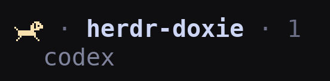

# Herdr Doxie

herdr のエージェント状態を、走る・座る・犬小屋に入る・寝るダックスフンドで表示します。
[English](README.md) | [日本語](README.ja.md) | [简体中文](README.zh-CN.md) | [한국어](README.ko.md)



Herdr のサイドバーで実際に動いている様子です。犬1匹はターミナルの2文字分で表示します。

| 状態 | 表示 |
| --- | --- |
| working | 走る |
| blocked | おすわり |
| done（終了・未確認） | 犬小屋から顔を出す |
| idle | 寝る（z → zZ → 文字なし） |
| unknown | 寝る止め絵 |

Spaces は「指示待ち > 動作中 > 寝る」の優先順です。エージェントがいなければ空の犬小屋になります。終了の既読状態はクライアントごとの情報なので、Spaces では done を idle として扱います。

Spaces は `row_gap = 1` で項目間に1行の余白を入れ、ブランチ情報がない項目でも犬同士の間隔を保ちます。詰めて表示したい場合は `0` に戻せます。一度に表示できる項目数は減ります。連続するインデント付き worktree 子項目はまとまった表示のままです。Agents の間隔は変更しません。

## 動作環境

macOS、**herdr 0.9.5 以降**、**Python 3.9 以降（curses を含む）**。実行時に pip パッケージは不要です。Linux はまだ対応を宣言せず、Windows は非対応です。

## 導入

公開先: [maromocooo/herdr-doxie](https://github.com/maromocooo/herdr-doxie)。この版の公開後は以下で導入できます。

```sh
herdr plugin install maromocooo/herdr-doxie
```

開発中のフォルダなら:

```sh
herdr plugin link /absolute/path/to/herdr-doxie
```

インストールだけではフォントと設定は変わりません。インストールした版と同じ版の `HerdrDoxie.ttf` と `config-snippet.toml` を用意します。管理下のインストール先は `herdr plugin list` の `plugin_root` で確認できます。

1. `HerdrDoxie.ttf` をダブルクリックして Font Book にインストールするか、`~/Library/Fonts/` にコピーします。
2. ターミナルに割り当て、ターミナルを再起動します。

   Ghostty (`~/.config/ghostty/config`):

   ```ini
   font-codepoint-map = U+10F000-U+10F0FF=Herdr Doxie
   ```

   kitty (`~/.config/kitty/kitty.conf`):

   ```ini
   symbol_map U+10F000-U+10F0FF Herdr Doxie
   narrow_symbols U+10F000-U+10F0FF 1
   ```

   ほかのターミナルは同等のフォント割り当てが必要です。今回の版で描画は未検証です。

3. `config-snippet.toml` の内容を `~/.config/herdr/config.toml` に統合します。**既存テーブルを重複させないでください。** Agents は `state_icon` を設定例の `state_text` オブジェクト（`rules` を含む）に替えます。Spaces も設定例の `$doxie` オブジェクトと `rules` を使い、ほかのトークンは保持します。両方の配色ルールを一度追加すれば、TUI から設定ファイルを書き換えずに切り替えられます。単純な文字列トークンでも犬は表示できますが、配色は切り替わりません。

   ```sh
   herdr server reload-config
   ```

4. 対象の herdr セッション内で操作タブを開きます。

   ```sh
   herdr plugin pane open --plugin herdr-doxie --entrypoint control
   ```

   **このタブが犬の処理を所有します。** ほかのタブへ移動しても動きます。`q`、操作タブを閉じる、サーバー終了のいずれかで停止します。startup hook はデーモンを監督しないため、切り離されたデーモンや自動起動フックは使いません。

フォント確認（9 匹）:

```sh
python3 -c 'print(" ".join(chr(0x10F000+2*i)+chr(0x10F001+2*i) for i in range(9)))'
```

## TUI の設定

上下キーで選び、左右キーで変更します。Space / Enter はオン／オフの切り替え、または1コマの時間を増やす操作です。即時保存し、実行中の処理にも反映します。

- **All animations**: 全アニメーションのオン／オフ。オフでも犬の止め絵は表示します。
- **Running dog**: 走るアニメーションだけ切り替えます。
- **Sleeping dog**: 寝ている犬の z / zZ だけ切り替えます。
- **Running frame / Sleeping frame**: 走る・寝るの1コマの時間を別々に調整します。短いほど速く、既定は 0.25 / 0.7 秒。0.1〜60 秒のプリセットから選べます。
- **Color theme**: Dark は淡い色、Light は明るい背景で見やすい濃い色です。設定画面の背景も切り替わります。herdr 全体やターミナルのテーマは変更しません。
- **Spaces spacing**: ON で Spaces の項目間に1行の余白、OFF で詰めた表示にします。アニメーションの設定とは独立しています。

全体をオフにしても個別のオン／オフ、速度、配色は保持します。設定はプラグイン全体で共有し、各セッションの実行中プロセスが読み直します。操作タブとは別に、設定だけのポップアップも開けます。

```sh
herdr plugin pane open --plugin herdr-doxie --entrypoint settings
```

保存先は `herdr plugin config-dir herdr-doxie` が示すフォルダの `settings.json` です。直接スクリプトを実行する場合は `~/.config/herdr/plugins/config/herdr-doxie/settings.json`（`XDG_CONFIG_HOME` に対応）。`HERDR_PLUGIN_CONFIG_DIR` があれば優先します。

**Spaces spacing** だけはアニメーション設定と別に Herdr の `config.toml` に保存します。現在の `ui.sidebar.spaces.row_gap` を読み、変更を `herdr config check` で検証してから、同じフォルダに非公開権限の `.config.toml.doxie-backup-*` を作成して保存・再読み込みします。再読み込みに失敗しても保存値は残り、TUI に再実行方法を表示します。`HERDR_CONFIG_PATH` があれば優先し、なければ `herdr --help` の設定パスを使います。設定例の `[ui.sidebar.spaces]` テーブルに対応しています。引用符付きテーブル名やドット付きキーなど別の書式は手動で変更してください。TUI を実行するマシンで同じ設定ファイルを使うセッションに影響します。SSH 経由で表示する場合は閲覧側のローカル設定を変更してください。worktree 子項目のまとまりは Herdr の仕様どおり詰めた表示です。

環境変数 `HERDR_DOXIE_ANIMATE=0` は全アニメーションを停止し、`HERDR_DOXIE_INTERVAL` と `HERDR_DOXIE_SLEEP_INTERVAL` は保存した速度より優先します。未指定なら TUI の設定値を使います（初期値 0.25 / 0.7 秒）。有効な上書きは TUI に表示します。保存値に戻すには環境変数を外して処理を再起動します。速度は 0.1〜60 秒の有限数です。

### 配色切り替えのための更新

同梱の **HerdrDoxie.ttf バージョン 1.040** を再インストールし、ターミナルを再起動します。`config-snippet.toml` の新しい `rules` を **Agents と Spaces の両方**に統合し、`herdr server reload-config` を実行してください。古いフォントでは Light 用の文字が表示できません。既存の設定ファイルには、既定の速度と Dark が自動で補われます。

配色は同じ設定ファイルを使うセッションで共有されます。同じサーバーを閲覧するクライアントごとに背景を自動判別するものではありません。配色を変えても状態の意味と犬の形は同じです。

## 停止・更新・削除

対象セッションの停止と表示解除:

```sh
herdr plugin action invoke herdr-doxie.clear
```

常駐処理の停止完了を待ってから解除します。別のソケットのプロセスには影響しません。元のドット表示に戻すには sidebar の行設定も戻してください。

更新前に、起動している**各セッションの**操作タブを閉じます。`herdr plugin update herdr-doxie` のあと、操作タブを開き直します。ローカルリンクなら編集後のファイルを使います。フォントを変更した場合は再インストールとターミナルの再起動が必要です。

削除は各セッションで clear → sidebar 設定を戻す → `herdr plugin uninstall herdr-doxie` の順です。ローカルリンクは `herdr plugin unlink herdr-doxie` を使います。フォントとターミナルの割り当ては手動で削除します。

**旧版からの移行:** `.zshrc` から旧版の自動起動行を削除し、旧プロセスを特定して停止します。ファイルを置き換える前に、旧スクリプトの `--clear` で旧メタデータを解除してください。旧版には新しい停止要求が届きません。フォント割り当ては `Herdr Doxie`、Space のトークンは `$doxie` に置き換えます。新版の `--daemon` は移行案内付きのエラーになります。

チェックアウトからの直接実行も可能です。

```sh
python3 herdr-doxie --panel     # 犬の処理と設定 TUI
python3 herdr-doxie             # フォアグラウンド。Ctrl+C で停止・解除
python3 herdr-doxie --settings  # 設定だけ
python3 herdr-doxie --clear     # この接続先を停止・解除
python3 herdr-doxie --once      # 実行中処理を止め、60 秒間の止め絵を登録
```

## 仕組みと制限

- 意味上のエージェント状態は変更せず、表示用メタデータだけを送ります。
- イベント購読の接続終了を検出したら終了します。サーバー再起動・handoff・イベント欠落などで終了した場合は操作タブを開き直します。
- ペインの作成・削除などはイベントで検出します。状態は 2 秒ごとに確認し、描画フレームごとには一覧 API を呼びません。状態イベントだけによる完全な駆動は今後の改善候補です。
- メタデータは 60 秒で失効し、通常は 20 秒以内に更新します。異常終了時も古い Space の犬が残り続けません。
- ソケットごとに 1 プロセスが順番に送信します。再起動時の番号巻き戻りを避けるため、メタデータの `seq` は使っていません。
- 通信エラーは通知し、CLI への大量フォールバックはしません。
- 行設定は展開時のデスクトップサイドバーだけに適用されます。リモートはサーバー側で実行し、フォントは閲覧側に入れます。

## 開発・公開前確認

```sh
python3 -m unittest discover -s tests -v
python3 -m venv .venv
.venv/bin/pip install -r requirements-dev.txt
.venv/bin/python preview.py assets/sprites.png
.venv/bin/python preview.py --gif assets/running.gif
.venv/bin/python build_font.py --advance 602 --out /tmp/HerdrDoxie.ttf
```

`sprites.py` の絵を編集できます。Dark は U+10F000〜U+10F011、Light は同じ絵を使う U+10F020〜U+10F031 です。各配色に16スプライト分の領域を予約しています。`ORDER` はコードポイントの対応なので既存順序を変えず、フォントを配布し直すときは `FONT_VERSION` を上げます。`--bleed` は左右境界の重なり、`--descent` は上下位置を調整します。

コード・オリジナルの絵・同梱フォントはすべて [MIT License](LICENSE) です。公開前には実サーバー・ターミナルでの目視確認が必要です。

[公式の掲載条件](https://herdr.dev/tui/docs/marketplace/)は、公開リポジトリのデフォルトブランチに manifest を置き、GitHub topic `herdr-plugin` を付けることです。
