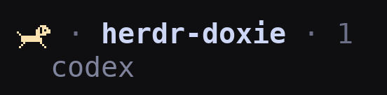

# Herdr Doxie

Herdr 에이전트 상태에 맞춰 달리고, 앉고, 개집에 들어가고, 잠드는 닥스훈트입니다.

[English](README.md) | [日本語](README.ja.md) | [简体中文](README.zh-CN.md) | [한국어](README.ko.md)



Herdr 사이드바에서 실제로 실행 중인 모습입니다. 강아지 한 마리가 터미널의 두 문자 칸을 사용합니다.

| 에이전트 상태 | 표시 |
| --- | --- |
| working | 달리는 애니메이션 |
| blocked | 앉아서 기다림 |
| done (완료, 아직 확인하지 않음) | 개집에서 얼굴을 내밂 |
| idle | z / zZ가 바뀌며 잠듦 |
| unknown | 잠자는 정지 그림 |

Spaces는 ‘입력 대기 > 작업 중 > 잠자기’ 순서로 에이전트 상태를 모읍니다. 에이전트가 없으면 빈 개집을 표시합니다. 완료 상태를 확인했는지는 Herdr 클라이언트별 정보이므로 Spaces에서는 done을 idle로 취급합니다.

Spaces는 `row_gap = 1`로 항목 사이에 한 줄을 비워 브랜치 정보가 없어도 강아지 사이의 간격을 유지합니다. 더 촘촘하게 보려면 `0`으로 바꾸세요. 한 번에 보이는 항목 수는 줄어들며, 연속으로 들여쓰기된 worktree 하위 항목은 간격 없이 묶여 표시됩니다. Agents 간격은 바꾸지 않습니다.

## 요구 사항

- macOS, **Herdr 0.9.5 이상**, `curses`가 포함된 **Python 3.9 이상**. 실행할 때 pip 패키지는 필요하지 않습니다.
- 동봉된 글꼴을 표시할 수 있는 터미널이 필요합니다. Ghostty와 kitty는 문자 범위별 글꼴 매핑을 지원합니다.
- Linux는 아직 지원 대상으로 선언하지 않았습니다. Unix 소켓과 `fcntl`을 사용하므로 Windows는 지원하지 않습니다.

## 설치

저장소: [maromocooo/herdr-doxie](https://github.com/maromocooo/herdr-doxie). 이 버전이 공개되면 다음 명령으로 설치합니다.

```sh
herdr plugin install maromocooo/herdr-doxie
```

로컬 개발 폴더를 연결하려면:

```sh
herdr plugin link /absolute/path/to/herdr-doxie
```

플러그인 설치는 글꼴을 설치하거나 터미널 및 Herdr 설정을 **자동으로 수정하지 않습니다**. 설치한 플러그인과 같은 버전의 `HerdrDoxie.ttf`, `config-snippet.toml`을 사용하세요. 관리되는 설치 위치는 `herdr plugin list`의 `plugin_root`에서 확인할 수 있습니다.

1. `HerdrDoxie.ttf`를 더블 클릭하여 서체 관리자에서 설치하거나 `~/Library/Fonts/`에 복사합니다.
2. 터미널에 글꼴을 매핑한 뒤 터미널을 다시 시작합니다.

   Ghostty (`~/.config/ghostty/config`):

   ```ini
   font-codepoint-map = U+10F000-U+10F0FF=Herdr Doxie
   ```

   kitty (`~/.config/kitty/kitty.conf`):

   ```ini
   symbol_map U+10F000-U+10F0FF Herdr Doxie
   narrow_symbols U+10F000-U+10F0FF 1
   ```

   다른 터미널에서도 동등한 글꼴 매핑이 필요합니다. 해당 터미널의 렌더링은 이번 버전에서 검증하지 않았습니다.

3. `config-snippet.toml`을 `~/.config/herdr/config.toml`에 병합합니다. **기존 TOML 테이블을 중복해서 추가하지 마세요.** 사용자 지정 행이 있다면 다른 토큰은 유지하고, Agents의 `state_icon`을 예제의 `state_text` 객체(`rules` 포함)로 바꿉니다. Spaces에는 `$doxie` 객체와 규칙을 사용합니다. 두 팔레트의 규칙을 한 번 추가하면 TUI에서 전환할 수 있습니다. 단순 문자열 토큰도 강아지는 표시하지만 색상 전환은 지원하지 않습니다.

   ```sh
   herdr server reload-config
   ```

4. 대상 Herdr 세션 안에서 제어 탭을 엽니다.

   ```sh
   herdr plugin pane open --plugin herdr-doxie --entrypoint control
   ```

   이 탭을 열어 두면 다른 탭으로 이동해도 계속 동작합니다. `q`를 누르거나 제어 탭을 닫거나 서버를 종료하면 실행 프로세스가 멈춥니다. 이 버전은 분리된 데몬이나 자동 시작 훅을 사용하지 않습니다. Herdr의 startup hook은 일회성 명령이며 데몬을 관리하지 않습니다.

글꼴 확인 (강아지 아홉 마리):

```sh
python3 -c 'print(" ".join(chr(0x10F000+2*i)+chr(0x10F001+2*i) for i in range(9)))'
```

## TUI 설정

위/아래 키로 항목을 선택하고 왼쪽/오른쪽 키로 값을 바꿉니다. Space / Enter는 스위치를 전환하거나 프레임 시간을 늘립니다. 변경 사항은 즉시 저장되어 실행 중인 프로세스에 적용됩니다.

- **All animations**: 전체 애니메이션 스위치입니다. 꺼도 정지 그림은 표시합니다.
- **Running dog**: 달리기 애니메이션을 개별적으로 켜거나 끕니다.
- **Sleeping dog**: 잠자는 강아지의 z / zZ 애니메이션을 개별적으로 켜거나 끕니다.
- **Running frame / Sleeping frame**: 달리기와 잠자기의 프레임 시간을 따로 조절합니다. **짧을수록 빠릅니다.** 기본값은 각각 0.25 / 0.7초이며, 0.1–60초 범위의 프리셋을 선택할 수 있습니다.
- **Color theme**: Dark는 밝은 파스텔색, Light는 밝은 배경에 어울리는 진한 색을 사용합니다. 설정 화면의 배경도 바뀌지만 Herdr 전체나 터미널의 테마는 바꾸지 않습니다.
- **Spaces spacing**: ON은 Spaces 항목 사이에 한 줄을 비우고, OFF는 촘촘하게 표시합니다. 애니메이션 스위치와 독립적입니다.

전체 스위치를 꺼도 개별 스위치, 속도, 배색은 유지합니다. 설정 파일은 이 플러그인을 실행하는 세션 사이에 공유되며 실행 중인 프로세스가 다시 읽습니다. 새 실행 프로세스를 시작하지 않고 설정만 편집하려면:

```sh
herdr plugin pane open --plugin herdr-doxie --entrypoint settings
```

설정은 `herdr plugin config-dir herdr-doxie`가 가리키는 폴더의 `settings.json`에 저장합니다. 직접 실행할 때는 `~/.config/herdr/plugins/config/herdr-doxie/settings.json`이 기본값이며 `XDG_CONFIG_HOME`을 지원합니다. Herdr가 제공하는 `HERDR_PLUGIN_CONFIG_DIR`가 우선합니다.

**Spaces spacing**은 Herdr의 `config.toml`에 별도로 저장합니다. TUI는 현재 `ui.sidebar.spaces.row_gap`을 읽고, `herdr config check`로 검증한 다음 같은 폴더에 현재 사용자만 읽고 쓸 수 있는 `.config.toml.doxie-backup-*` 백업을 만들고 저장 및 다시 불러오기를 요청합니다. 다시 불러오기에 실패해도 저장값은 유지되며 재시도 방법을 표시합니다. `HERDR_CONFIG_PATH`를 우선하고, 없으면 `herdr --help`에 표시된 경로를 사용합니다. 예제의 `[ui.sidebar.spaces]` 테이블을 지원하며, 따옴표가 있는 테이블 이름이나 점으로 구분된 키 등 다른 형식은 직접 수정해야 합니다. TUI를 실행하는 머신에서 같은 설정을 쓰는 세션에 적용됩니다. SSH로 보는 경우에는 보는 쪽의 로컬 설정을 변경하세요. worktree 하위 항목은 Herdr 규칙에 따라 촘촘한 그룹으로 유지됩니다.

환경 변수가 저장된 설정보다 우선합니다. `HERDR_DOXIE_ANIMATE=0`은 모든 애니메이션을 끄고, `HERDR_DOXIE_INTERVAL`과 `HERDR_DOXIE_SLEEP_INTERVAL`은 달리기와 잠자기의 프레임 시간을 덮어씁니다 (0.1–60초의 유한한 수). 지정하지 않으면 TUI의 저장값을 사용합니다. 적용 중인 환경 변수는 TUI에 표시됩니다. 저장값으로 돌아가려면 변수를 제거하고 실행 프로세스를 다시 시작하세요. `HERDR_SOCKET_PATH`로 대상 서버를 지정할 수 있습니다.

### 배색 전환을 위한 업데이트

동봉된 **HerdrDoxie.ttf 1.040**을 다시 설치하고 터미널을 재시작합니다. `config-snippet.toml`의 새 `rules`를 **Agents와 Spaces 양쪽**에 병합하고 `herdr server reload-config`를 실행하세요. 이전 글꼴은 Light 팔레트용 문자를 표시할 수 없습니다. 기존 설정 파일에는 기본 속도와 Dark 테마가 자동으로 보충됩니다.

같은 설정 파일을 사용하는 프로세스는 배색을 공유합니다. 같은 서버를 보는 클라이언트에는 같은 선택이 표시되며, 각 클라이언트의 배경을 자동으로 감지하지 않습니다. 배색을 바꿔도 상태의 의미와 강아지 모양은 같습니다.

## 중지, 업데이트, 제거

현재 세션의 실행 프로세스를 중지하고 아이콘을 지우려면:

```sh
herdr plugin action invoke herdr-doxie.clear
```

대상 소켓의 실행 프로세스가 종료될 때까지 기다린 뒤 메타데이터를 지웁니다. 다른 세션의 프로세스는 종료하지 않습니다. 원래의 점 표시로 돌아가려면 sidebar 행 설정도 복원해야 합니다.

업데이트 전에는 **실행 중인 모든 세션**의 제어 탭을 닫고 `herdr plugin update herdr-doxie`를 실행한 뒤 다시 엽니다. 로컬 링크는 수정된 파일을 바로 사용합니다. 글꼴이 바뀌었다면 다시 설치하고 터미널을 재시작하세요.

제거 순서: 각 세션에서 clear → sidebar 설정 복원 → `herdr plugin uninstall herdr-doxie`. 로컬 링크라면 `herdr plugin unlink herdr-doxie`를 사용합니다. 글꼴과 터미널 매핑은 수동으로 제거합니다.

**이전 스크립트에서 이전하기:** `.zshrc`의 이전 자동 실행 행을 제거하고 이전 프로세스를 확인하여 중지합니다. 파일을 교체하기 전에 이전 스크립트의 `--clear`로 이전 메타데이터를 지우세요. 이전 프로세스는 새 중지 프로토콜을 지원하지 않습니다. 글꼴 매핑은 `Herdr Doxie`, Space 토큰은 `$doxie`로 바꿉니다. 새 버전에서 `--daemon`은 이전 안내 오류를 표시합니다.

로컬 폴더에서 직접 실행할 수도 있습니다.

```sh
python3 herdr-doxie --panel     # 아이콘과 설정 TUI
python3 herdr-doxie             # 포그라운드 실행; Ctrl+C로 중지 및 삭제
python3 herdr-doxie --settings  # 설정만 편집
python3 herdr-doxie --clear     # 이 서버의 실행 프로세스 중지 및 아이콘 삭제
python3 herdr-doxie --once      # 프로세스를 중지하고 60초 동안 정지 아이콘 표시
```

## 동작과 제한

- 표시용 메타데이터만 바꾸며 에이전트의 실제 상태는 변경하지 않습니다.
- 지속적인 이벤트 연결로 서버를 감시합니다. 연결이 닫히거나 오류가 발생하면 종료하며 다른 서버에 자동 재접속하지 않습니다. 서버 재시작, handoff 또는 이벤트 오류 이후 제어 탭을 다시 여세요.
- 생성·닫기 등의 이벤트가 목록을 갱신합니다. 에이전트 상태는 2초마다 확인하며 애니메이션 프레임마다 `agent.list`를 호출하지 않습니다. 상태 이벤트만 사용하는 완전한 이벤트 기반 갱신은 추후 개선 항목입니다.
- 메타데이터는 보통 20초 이내에 갱신하며 60초 동안 갱신되지 않으면 만료됩니다. 비정상 종료 후에도 Spaces에 오래된 상태가 영구적으로 남지 않습니다.
- 소켓마다 하나의 프로세스가 순서대로 전송합니다. 재시작 후 번호가 되돌아가는 문제를 피하려고 메타데이터 `seq`는 사용하지 않습니다. API 오류를 표시하며 CLI 프로세스를 대량 실행하지 않습니다.
- 행 설정은 펼쳐진 데스크톱 사이드바에만 적용됩니다. 원격 서버에는 별도의 실행 프로세스가 필요하고, 글꼴은 화면을 보는 쪽에 설치합니다.
- 실제 터미널과 서버에서의 표시 검증은 아직 필요합니다.

## 개발과 배포

```sh
python3 -m unittest discover -s tests -v
python3 -m venv .venv
.venv/bin/pip install -r requirements-dev.txt
.venv/bin/python preview.py assets/sprites.png
.venv/bin/python preview.py --gif assets/running.gif
.venv/bin/python build_font.py --advance 602 --out /tmp/HerdrDoxie.ttf
```

`sprites.py`에서 픽셀 그림을 수정합니다. `ORDER` 순서를 유지하세요. Dark는 U+10F000–U+10F011, 같은 윤곽을 사용하는 Light 별칭은 U+10F020–U+10F031을 사용하며 팔레트마다 16개 스프라이트 공간을 예약합니다. 수정한 글꼴을 배포할 때는 `FONT_VERSION`을 올립니다. `--advance`, `--bleed`, `--descent`는 각각 문자 폭, 이음새 겹침, 수직 위치를 조절합니다. 미리보기에는 Pillow, 글꼴 생성에는 fonttools와 skia-pathops가 필요합니다.

코드, 원본 픽셀 그림, 동봉 글꼴은 모두 [MIT License](LICENSE)입니다. manifest는 Herdr 0.9.5의 링크 검증을 통과했으며, 공개 전 실제 환경 검증이 필요합니다. 공개 GitHub 저장소의 기본 브랜치에 manifest를 두고 `herdr-plugin` topic을 추가하면 마켓플레이스 검색 대상이 됩니다. [공식 등록 안내](https://herdr.dev/tui/docs/marketplace/)와 [플러그인 수명 주기 문서](https://herdr.dev/tui/docs/plugins/)를 참고하세요.
