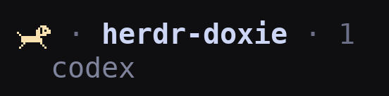

# Herdr Doxie

Dachshunds that run, sit, go home and sleep with your Herdr agents.
[English](README.md) | [日本語](README.ja.md) | [简体中文](README.zh-CN.md) | [한국어](README.ko.md)



Herdr Doxie in action in the Herdr sidebar. The font uses two terminal cells per dog.

| Agent state | Dog |
| --- | --- |
| Working | Running (animated) |
| Blocked | Sitting |
| Done, not yet viewed | Peeking out of its house |
| Idle | Sleeping, with animated z / zZ |
| Unknown | Static sleeping dog |

Spaces aggregate their agents: blocked > working > sleeping. Empty Spaces show an empty house. Done is treated as idle in Spaces because viewed/unviewed state belongs to each Herdr client.

Spaces use `row_gap = 1` to leave one blank line between entries, including those without branch information. Set it to `0` for a denser list. This reduces the number of entries visible at once; consecutive indented worktree children remain grouped without gaps. Agents keep their existing spacing.

## Requirements

- macOS, Herdr **0.9.5+**, Python **3.9+** with `curses` (no pip packages needed to run).
- A terminal capable of displaying the bundled font. Ghostty and kitty support explicit codepoint mapping.
- Linux is not declared supported yet; Windows is unsupported (Unix sockets and `fcntl` are required).

## Install

Repository: [maromocooo/herdr-doxie](https://github.com/maromocooo/herdr-doxie). Once this version is published:

```sh
herdr plugin install maromocooo/herdr-doxie
```

For a local checkout:

```sh
herdr plugin link /absolute/path/to/herdr-doxie
```

Installation does **not** install the font or edit your terminal/Herdr configuration. Obtain `HerdrDoxie.ttf` and `config-snippet.toml` from the same release/checkout as the installed plugin. For a managed install, `herdr plugin list` shows its `plugin_root`.

1. Double-click `HerdrDoxie.ttf` to install it in Font Book (or copy it to `~/Library/Fonts/`).
2. Map the codepoints in your terminal, then restart that terminal:

   Ghostty (`~/.config/ghostty/config`):

   ```ini
   font-codepoint-map = U+10F000-U+10F0FF=Herdr Doxie
   ```

   kitty (`~/.config/kitty/kitty.conf`):

   ```ini
   symbol_map U+10F000-U+10F0FF Herdr Doxie
   narrow_symbols U+10F000-U+10F0FF 1
   ```

   Other terminals need an equivalent font fallback/codepoint mapping. Their rendering has not been verified for this release.

3. Merge `config-snippet.toml` into `~/.config/herdr/config.toml`. **Do not duplicate existing TOML tables.** If you already customize Agents rows, replace `state_icon` with the `state_text` token object from the snippet (including its `rules`). In Spaces rows use the `$doxie` token object and its rules, keeping your other tokens. Install both palettes once; the TUI selects dark or light colors without editing your configuration. Plain tokens still show dogs, but cannot switch colors. Reload:

   ```sh
   herdr server reload-config
   ```

4. Inside the target Herdr session, open the control tab:

   ```sh
   herdr plugin pane open --plugin herdr-doxie --entrypoint control
   ```

   Keep this tab open; you can switch to other tabs while the dogs run. Pressing `q`, closing the control tab, or stopping the server stops its runner. This version deliberately has no detached daemon or automatic startup hook: Herdr startup hooks are one-shot commands, not daemon supervisors.

Check the font (nine dogs):

```sh
python3 -c 'print(" ".join(chr(0x10F000+2*i)+chr(0x10F001+2*i) for i in range(9)))'
```

## TUI settings

Use Up/Down to select and Left/Right to change a value in the control tab. Space/Enter toggles switches or increases frame duration. Changes save immediately and apply to live runners:

- **All animations**: master switch. OFF keeps static dogs visible.
- **Running dog**: independently enable/disable the running frames.
- **Sleeping dog**: independently enable/disable the z / zZ frames.
- **Running frame** / **Sleeping frame**: independent frame durations. Shorter means faster. Defaults: 0.25 / 0.7 seconds; presets span 0.1–60 seconds.
- **Color theme**: Dark (pastel dogs) or Light (darker dogs). Also changes the settings screen background. It does not change Herdr's overall theme or your terminal theme.
- **Spaces spacing**: ON inserts one blank row between Spaces; OFF uses a compact list. Independent of the animation switches.

Turning the master switch off preserves individual switches, speeds and theme. Settings are shared across sessions for this plugin and live runners reload them. To edit without starting another runner:

```sh
herdr plugin pane open --plugin herdr-doxie --entrypoint settings
```

Settings are stored in `settings.json` under `herdr plugin config-dir herdr-doxie`. Standalone execution uses `$XDG_CONFIG_HOME/herdr/plugins/config/herdr-doxie` (default `~/.config/herdr/plugins/config/herdr-doxie`). A `HERDR_PLUGIN_CONFIG_DIR` supplied by Herdr takes precedence.

**Spaces spacing** is stored in Herdr’s `config.toml`, separately from animation preferences. The TUI reads its current `ui.sidebar.spaces.row_gap`, validates changes with `herdr config check`, saves a private `.config.toml.doxie-backup-*` beside the config, then requests a reload. If reload fails, the saved value remains and the TUI shows how to retry. It honors `HERDR_CONFIG_PATH`; otherwise it uses the path reported by `herdr --help`. Use the `[ui.sidebar.spaces]` table from the snippet; alternative quoted or dotted-key layouts must be edited manually. This affects sessions using that config on the machine running the TUI. For SSH viewing, adjust the viewing client’s local config. Worktree child groups keep Herdr’s compact spacing.

Optional environment overrides take precedence over saved preferences. The TUI identifies active overrides; remove them and restart the runner to use saved speeds:

| Variable | Default | Meaning |
| --- | --- | --- |
| `HERDR_DOXIE_ANIMATE` | `1` | `0` forces all animations off; the UI shows this override |
| `HERDR_DOXIE_INTERVAL` | Saved value (initially `0.25`) | Running frame duration, 0.1–60 seconds |
| `HERDR_DOXIE_SLEEP_INTERVAL` | Saved value (initially `0.7`) | Sleeping frame duration, 0.1–60 seconds |
| `HERDR_SOCKET_PATH` | Herdr session socket | Explicit target server |

### Upgrading for theme switching

Reinstall the bundled **HerdrDoxie.ttf version 1.040** and restart your terminal. Merge the new `rules` for **both** Agents and Spaces from `config-snippet.toml`, then run `herdr server reload-config`. An old font cannot display the Light palette aliases. Existing settings files gain default speeds and the Dark theme automatically.

The chosen palette is shared with other runners using the same settings file. Clients viewing the same server see the same selection; it does not auto-detect each client's background. Both palettes keep the same status meanings and dog shapes.

## Stop, update and remove

Stop and remove this session's metadata:

```sh
herdr plugin action invoke herdr-doxie.clear
```

This waits for the endpoint-specific runner to stop before clearing. It does not kill runners in other sessions. Restore your previous sidebar rows to get the original dots back.

Before updating, close the Doxie control tab in **each running session**, then run `herdr plugin update herdr-doxie` and reopen the tabs. Local links use the edited checkout instead. If the font changed, reinstall it and restart your terminal. Before uninstalling, clear each session, restore sidebar rows, then run `herdr plugin uninstall herdr-doxie` (or `herdr plugin unlink herdr-doxie` for a local link). Font removal and terminal mappings are manual.

**Migrating from the old script:** remove its automatic launch line from `.zshrc`, identify and stop its old processes, then run the old script with `--clear` before replacing it. Old runners do not implement the new cooperative stop protocol. Replace the old font mapping with `Herdr Doxie` and the Space token with `$doxie`. `--daemon` now reports a migration error.

Standalone checkout commands:

```sh
python3 herdr-doxie --panel     # icons + settings, owned by this terminal
python3 herdr-doxie             # foreground runner; Ctrl+C stops and clears
python3 herdr-doxie --settings  # settings only
python3 herdr-doxie --clear     # stop this endpoint and clear
python3 herdr-doxie --once      # stop runner; static icons expire after 60 seconds
```

## Behavior and limitations

- Display-only metadata never changes the underlying agent lifecycle.
- A persistent event connection watches the server lifetime. EOF or stream errors stop the runner; it does not silently reconnect to a replacement server. Reopen the control tab after server restart/handoff or a reported stream error.
- Lifecycle events invalidate the pane list. Agent state is reconciled every two seconds; animation frames do not query `agent.list`. Full status-event subscriptions are a future optimization.
- All labels/tokens expire after 60 seconds without renewal (normally renewed within 20 seconds). After a crash, stale Space icons disappear rather than remaining indefinitely.
- Writes are serialized by one runner per socket. No metadata `seq` is used, avoiding sequence resets after process restarts. Socket/API failures are surfaced; no CLI fallback process storm occurs.
- Rows affect the expanded desktop sidebar only. Remote servers need their own runner; fonts belong on the viewing machine.
- The configured colors may need adjustment for your theme. Terminal font rendering still requires manual visual verification.

## Development

```sh
python3 -m unittest discover -s tests -v
python3 -m venv .venv
.venv/bin/pip install -r requirements-dev.txt
.venv/bin/python preview.py assets/sprites.png
.venv/bin/python preview.py --gif assets/running.gif
.venv/bin/python build_font.py --advance 602 --out /tmp/HerdrDoxie.ttf
```

Edit `sprites.py` to change the pixels. Keep `ORDER` stable: it defines the public codepoint mapping. Dark glyphs use U+10F000–U+10F011; Light aliases use U+10F020–U+10F031 and reuse the same outlines. The builder reserves 16 sprite slots per palette. Increase `FONT_VERSION` in `build_font.py` when distributing changed glyphs. `--advance`, `--bleed`, and `--descent` tune cell width, seam overlap, and vertical position. Preview generation needs Pillow; font generation needs fonttools and skia-pathops.

## Publication status

The code, original sprites and bundled font are all covered by the [MIT License](LICENSE). The manifest can be linked with Herdr 0.9.5. Live terminal/server verification is still required before release.

To be indexed, publish a public repository with this manifest on its default branch and add the `herdr-plugin` GitHub topic. See [Herdr's marketplace instructions](https://herdr.dev/tui/docs/marketplace/) and [plugin lifecycle documentation](https://herdr.dev/tui/docs/plugins/).
