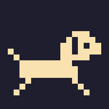

# Herdr Doxie

让腊肠犬随着 Herdr 智能体的状态奔跑、坐下、回到狗屋或睡觉。

[English](README.md) | [日本語](README.ja.md) | [简体中文](README.zh-CN.md) | [한국어](README.ko.md)



这是像素图预览，不是终端截图。每只狗占两个终端字符单元。

| 智能体状态 | 显示 |
| --- | --- |
| working | 奔跑的动画 |
| blocked | 坐下等待 |
| done（已完成、尚未查看） | 从狗屋探出头 |
| idle | 睡觉，z / zZ 交替显示 |
| unknown | 静止的睡姿 |

Spaces 按“等待输入 > 工作中 > 睡觉”的优先级汇总状态。没有智能体时显示空狗屋。完成状态是否已查看由各个 Herdr 客户端管理，因此 Spaces 将 done 视为 idle。

## 运行环境

- macOS、**Herdr 0.9.5+**、带有 `curses` 的 **Python 3.9+**。运行时无需安装 pip 包。
- 终端需要支持附带的字体。Ghostty 和 kitty 可以指定字符范围的字体映射。
- 暂未声明支持 Linux；不支持 Windows，因为使用了 Unix socket 和 `fcntl`。

## 安装

仓库：[maromocooo/herdr-doxie](https://github.com/maromocooo/herdr-doxie)。此版本发布后，可运行：

```sh
herdr plugin install maromocooo/herdr-doxie
```

本地开发版本：

```sh
herdr plugin link /absolute/path/to/herdr-doxie
```

安装插件**不会**自动安装字体或修改终端、Herdr 的配置。请使用与插件版本一致的 `HerdrDoxie.ttf` 和 `config-snippet.toml`。`herdr plugin list` 中的 `plugin_root` 显示托管安装的目录。

1. 双击 `HerdrDoxie.ttf`，通过“字体册”安装，或复制到 `~/Library/Fonts/`。
2. 在终端中配置字体映射，然后重新启动终端。

   Ghostty (`~/.config/ghostty/config`)：

   ```ini
   font-codepoint-map = U+10F000-U+10F0FF=Herdr Doxie
   ```

   kitty (`~/.config/kitty/kitty.conf`)：

   ```ini
   symbol_map U+10F000-U+10F0FF Herdr Doxie
   narrow_symbols U+10F000-U+10F0FF 1
   ```

   其他终端需要等效的字体映射；此版本尚未验证其显示效果。

3. 将 `config-snippet.toml` 合并到 `~/.config/herdr/config.toml`。**不要重复添加已有的 TOML 表。** 如果已有自定义行，保留其他字段，将 Agents 的 `state_icon` 替换为示例中的 `state_text` 对象（包括 `rules`），Spaces 使用 `$doxie` 对象及其规则。一次性添加两套配色规则后，即可在 TUI 中切换。单独使用字符串 token 仍能显示狗，但不能切换配色。

   ```sh
   herdr server reload-config
   ```

4. 在目标 Herdr 会话中打开控制标签页：

   ```sh
   herdr plugin pane open --plugin herdr-doxie --entrypoint control
   ```

   保持这个标签页打开即可；切换到其他标签页后仍会运行。按 `q`、关闭控制标签页或停止服务器会停止该进程。此版本不使用脱离终端的守护进程，也不使用自动启动钩子：Herdr 的 startup hook 是一次性命令，不负责管理守护进程。

检查字体（应显示九只狗）：

```sh
python3 -c 'print(" ".join(chr(0x10F000+2*i)+chr(0x10F001+2*i) for i in range(9)))'
```

## TUI 设置

使用上下键选择，左右键调整。Space / Enter 用于切换开关或增加每帧时长。更改会立即保存，并应用到正在运行的进程。

- **All animations**：全部动画的总开关。关闭后仍显示静止的狗。
- **Running dog**：单独开关奔跑动画。
- **Sleeping dog**：单独开关睡觉时的 z / zZ 动画。
- **Running frame / Sleeping frame**：分别设置奔跑、睡觉的每帧时长。**时间越短，动画越快。** 默认分别为 0.25 / 0.7 秒，可选预设范围为 0.1–60 秒。
- **Color theme**：Dark 使用浅色，Light 使用适合浅色背景的深色。设置界面的背景也会切换，但不会修改整个 Herdr 或终端的主题。

关闭总开关不会丢失单独开关、速度和配色设置。同一设置文件由插件的各个会话共享，运行中的进程会重新读取。只调整设置而不启动另一个进程：

```sh
herdr plugin pane open --plugin herdr-doxie --entrypoint settings
```

设置保存在 `herdr plugin config-dir herdr-doxie` 所指目录的 `settings.json` 中。独立运行时，默认为 `~/.config/herdr/plugins/config/herdr-doxie/settings.json`，支持 `XDG_CONFIG_HOME`；Herdr 提供的 `HERDR_PLUGIN_CONFIG_DIR` 优先。

环境变量优先于保存的设置：`HERDR_DOXIE_ANIMATE=0` 强制关闭动画；`HERDR_DOXIE_INTERVAL` 和 `HERDR_DOXIE_SLEEP_INTERVAL` 分别覆盖奔跑和睡觉的每帧时长（必须为 0.1–60 秒的有限数）。未设置时使用 TUI 保存的值。TUI 会提示生效的覆盖项；移除环境变量并重启进程后，才会恢复使用保存的值。`HERDR_SOCKET_PATH` 可指定目标服务器。

### 为配色切换升级

重新安装附带的 **HerdrDoxie.ttf 1.040**，并重启终端。将 `config-snippet.toml` 中的新 `rules` 合并到 **Agents 和 Spaces 两处**，然后执行 `herdr server reload-config`。旧字体无法显示 Light 配色所用的字符。旧设置文件会自动补上默认速度和 Dark 配色。

配色由使用同一设置文件的进程共享。同一服务器的客户端会看到同一选择，不会根据各客户端的背景自动判断。切换配色不会改变状态含义或狗的形状。

## 停止、更新与卸载

停止当前会话的进程并清除图标：

```sh
herdr plugin action invoke herdr-doxie.clear
```

该操作会等待当前 socket 对应的进程停止后再清除元数据，不会杀掉其他会话的进程。要恢复原来的圆点，还需恢复 sidebar 的行配置。

更新前，关闭**每个运行中会话**的控制标签页，执行 `herdr plugin update herdr-doxie`，然后重新打开。使用本地链接时直接使用修改后的文件。字体有变化时，需要重新安装字体并重启终端。

卸载顺序：在各会话中 clear → 恢复 sidebar 配置 → `herdr plugin uninstall herdr-doxie`。本地链接使用 `herdr plugin unlink herdr-doxie`。字体和终端字体映射需手动移除。

**从旧脚本迁移：** 删除 `.zshrc` 中旧版的自动启动行，确认并停止旧进程；替换文件前，使用旧脚本的 `--clear` 清除旧元数据。旧进程不支持新的停止协议。字体映射改为 `Herdr Doxie`，Space token 改为 `$doxie`。新版的 `--daemon` 会显示迁移错误提示。

也可在本地目录直接运行：

```sh
python3 herdr-doxie --panel     # 图标和设置 TUI
python3 herdr-doxie             # 前台运行；Ctrl+C 停止并清除
python3 herdr-doxie --settings  # 只编辑设置
python3 herdr-doxie --clear     # 停止当前服务器对应的进程并清除
python3 herdr-doxie --once      # 停止进程，显示静止图标，60 秒后失效
```

## 工作方式与限制

- 只更新显示元数据，不改变智能体的实际生命周期状态。
- 持续的事件连接用于监测服务器。连接关闭或事件流报错后进程会退出，不会自动连接替代服务器。服务器重启、handoff 或事件错误后，请重新打开控制标签页。
- 创建、关闭等事件触发列表刷新。智能体状态每两秒校准一次；动画的每一帧不会调用 `agent.list`。完全基于状态事件的更新仍是后续优化项。
- 元数据通常在 20 秒内刷新，60 秒没有刷新则失效。崩溃后，Spaces 不会永久保留旧状态。
- 每个 socket 仅有一个进程按顺序写入；不使用可能在重启后回退的元数据 `seq`。API 错误会显示，不会大量启动 CLI 进行回退。
- 行配置只影响展开的桌面侧边栏。远程服务器需运行自己的插件进程；字体安装在查看界面的一侧。
- 仍需在实际终端和服务器上验证显示效果。

## 开发与发布

```sh
python3 -m unittest discover -s tests -v
python3 -m venv .venv
.venv/bin/pip install -r requirements-dev.txt
.venv/bin/python preview.py assets/sprites.png
.venv/bin/python preview.py --gif assets/running.gif
.venv/bin/python build_font.py --advance 602 --out /tmp/HerdrDoxie.ttf
```

在 `sprites.py` 中修改像素图。保持 `ORDER` 顺序不变：Dark 使用 U+10F000–U+10F011，Light 别名使用 U+10F020–U+10F031，复用同一轮廓；每套配色预留 16 个图像位置。发布修改后的字体时增加 `FONT_VERSION`。`--advance`、`--bleed`、`--descent` 分别调整字符宽度、接缝重叠和垂直位置。预览需要 Pillow；生成字体需要 fonttools 和 skia-pathops。

代码、原创像素图和附带字体均采用 [MIT License](LICENSE)。manifest 已通过 Herdr 0.9.5 的链接验证；发布前仍需实机验证。要被市场收录，在公开 GitHub 仓库的默认分支放置 manifest，并添加 `herdr-plugin` topic。参见[官方收录说明](https://herdr.dev/tui/docs/marketplace/)和[插件生命周期说明](https://herdr.dev/tui/docs/plugins/)。
